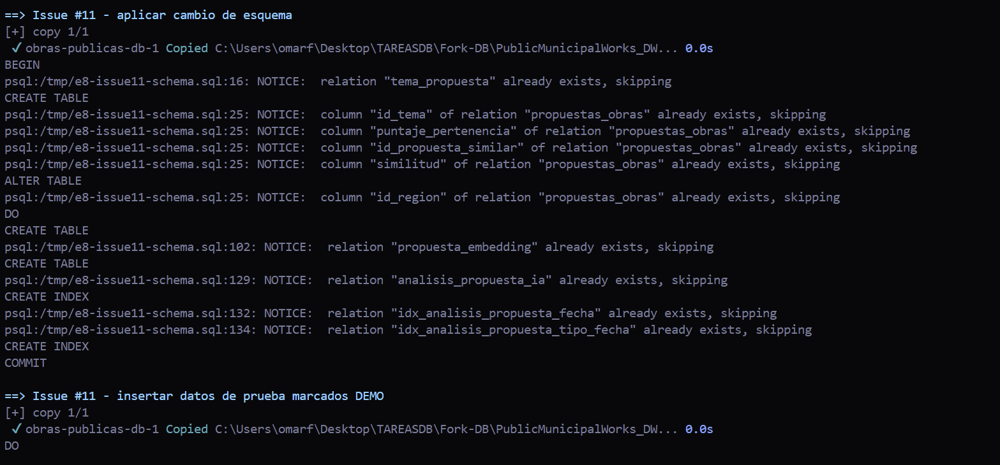
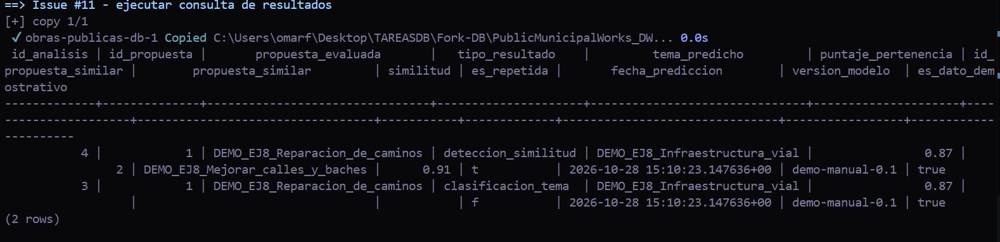

# Ejercicio 8. Cambio de esquema por integrante

**Propuesta:** [#11 — Agrupar por tema las propuestas de la gente y avisar cuando se repiten](https://github.com/oatbrend/PRACTICA2-DB/issues/11)  
**Autor de la issue original:** `OmarFloresIIA`  
**Área:** Ingeniería en Inteligencia Artificial  
**Fecha de ejecución documentada:** 28 de octubre de 2026  
**Motor:** PostgreSQL ejecutado con Docker Compose, sobre la base local `obras_publicas`.

## 1. Tablas, columnas y restricciones nuevas

La propuesta consiste en agrupar propuestas ciudadanas por tema y detectar textos con significado similar. El cambio se aplicó sobre el esquema operacional definido en `db/DDLBASEObPub.sql`.

- **`tema_propuesta`**: catálogo de temas con PK `id_tema`, nombre único, palabras clave y versión del modelo.
- **`propuestas_obras`**: añade `id_tema`, `puntaje_pertenencia`, `id_propuesta_similar`, `similitud` e `id_region`. Las FK permiten vincular una propuesta con el tema asignado, una posible propuesta duplicada y una región. `id_region` permanece nullable porque `region` era texto libre y los valores existentes deben mapearse a `region.id_region` antes de considerar su obligatoriedad. Los puntajes se restringen al intervalo [0, 1] y una propuesta no puede apuntarse a sí misma como similar.
- **`propuesta_embedding`**: almacena el vector numérico de una propuesta, su versión de modelo y la fecha de generación. La combinación de propuesta y versión del modelo es única.
- **`analisis_propuesta_ia`**: conserva los resultados históricos. Cada fila identifica la propuesta evaluada, tipo de resultado, tema predicho, posible propuesta similar, puntajes, bandera de repetición, fecha de predicción, versión del modelo y datos adicionales en JSONB.

## Tipos de dato elegidos

Los puntajes y la similitud usan `DOUBLE PRECISION`, porque son valores continuos y pueden guardar decimales como 0.87 y 0.91; las restricciones `CHECK` evitan valores fuera de [0, 1]. `TIMESTAMPTZ` conserva el instante de predicción con zona horaria. `version_modelo` usa texto para admitir identificadores de versión como `sentence-transformer-v2.1`. `salida_modelo` usa `JSONB` para mantener metadatos estructurados sin alterar la tabla cada vez que el modelo produzca un campo adicional. El embedding se guarda como `DOUBLE PRECISION[]`, una opción nativa de PostgreSQL que no exige instalar la extensión `pgvector`. El servicio de IA tendría que calcular los embeddings y la similitud y persistir los resultados; esta práctica solo prueba el almacenamiento y la consulta de salidas sintéticas.

## 2. Archivo SQL y ejecución

El cambio principal está en [`db/cambio-usuario.sql`](https://github.com/OmarFloresIIA/PublicMunicipalWorks_DWH/blob/TestDefinitivo/db/cambio-usuario.sql). El archivo contiene `CREATE TABLE`, `ALTER TABLE`, claves foráneas, restricciones e índices. Se ejecutó sobre la copia local de la base del proyecto, después de inicializar el esquema operacional.

Los datos de prueba están en [`db/diagramas/datos-demo-ejercicio8.sql`](https://github.com/OmarFloresIIA/PublicMunicipalWorks_DWH/blob/TestDefinitivo/db/diagramas/datos-demo-ejercicio8.sql). Crean un poblador y dos propuestas de demostración, y agregan resultados sintéticos identificados por la versión `demo-manual-0.1`. **No son resultados de un modelo de IA realmente ejecutado.**

La primera ejecución de la consulta detectó un alias SQL inválido (`similar`). Se corrigió a `propuesta_similar`, se actualizó el archivo y se volvió a ejecutar la secuencia. La ejecución final quedó completada sin errores. Los avisos `already exists, skipping` de la repetición son esperados porque el esquema usa instrucciones idempotentes para no recrear objetos ya existentes.

## 3. Consulta que depende del cambio y resultado

La consulta se encuentra en [`db/diagramas/consulta-ejercicio8.sql`](https://github.com/OmarFloresIIA/PublicMunicipalWorks_DWH/blob/TestDefinitivo/db/diagramas/consulta-ejercicio8.sql). Une `analisis_propuesta_ia` con `propuestas_obras`, `tema_propuesta` y la propuesta similar. Recupera el tema asignado, los puntajes, la posible propuesta repetida, la marca temporal y la versión del modelo. No puede ejecutarse sobre el esquema original porque este no contiene las nuevas tablas ni las columnas utilizadas.

La consulta final devolvió **2 filas**:

| Resultado | Propuesta evaluada | Tema | Puntaje de pertenencia | Propuesta similar | Similitud | ¿Repetida? | Versión | DEMO |
|---|---|---|---:|---|---:|---|---|---|
| Detección de similitud | `DEMO_EJ8_Reparacion_de_caminos` | `DEMO_EJ8_Infraestructura_vial` | 0.87 | `DEMO_EJ8_Mejorar_calles_y_baches` | 0.91 | Sí | `demo-manual-0.1` | `true` |
| Clasificación temática | `DEMO_EJ8_Reparacion_de_caminos` | `DEMO_EJ8_Infraestructura_vial` | 0.87 | Sin propuesta similar registrada en ese resultado | — | No | `demo-manual-0.1` | `true` |

La salida confirma que el esquema conserva clasificación y similitud como resultados distintos, ambos asociados a la propuesta y a la versión del modelo. El atributo `es_dato_demostrativo = true` deja claro que se trata de una prueba sintética.

## 4. Nota de media cuartilla: regla, estrategia y datos existentes

El cambio aplica principalmente la **regla 1**, porque añade las entidades `tema_propuesta`, `propuesta_embedding` y `analisis_propuesta_ia`. También aplica la **regla 4**, pues cada propuesta puede referenciar un tema, otra propuesta candidata a duplicado y una región mediante claves foráneas. La estrategia separa la representación numérica del texto de las salidas del análisis: `propuesta_embedding` guarda el vector de entrada generado por un modelo, mientras que `analisis_propuesta_ia` conserva la clasificación o detección, con fecha, versión de modelo y la FK a la propuesta evaluada. Esta separación permite registrar nuevas predicciones sin sobrescribir las anteriores y facilita comparar versiones del modelo.

Se eligieron `DOUBLE PRECISION` para puntajes continuos, `TIMESTAMPTZ` para el momento de la predicción, texto para la versión del modelo y `JSONB` para metadatos complementarios. El embedding se almacena como `DOUBLE PRECISION[]` para no introducir una dependencia de `pgvector`. Los registros existentes no se eliminan ni se recalculan al aplicar el cambio. Las columnas nuevas en `propuestas_obras` quedan en `NULL` hasta que se procese cada propuesta. `id_region` también queda nullable porque primero debe mapearse el texto libre existente a identificadores válidos de `region`. Las tablas de embeddings y resultados no contenían análisis previos; las filas observadas se insertaron con fines demostrativos y no deben confundirse con salidas reales de un modelo entrenado.

## 5. Evidencia de ejecución

Las siguientes capturas provienen de la ejecución local con Docker Compose y `psql`. La primera muestra el respaldo creado antes de aplicar la secuencia; la segunda registra la aplicación repetible del esquema y la carga de datos de demostración; la tercera muestra las dos filas devueltas por la consulta.

### Respaldo antes de los cambios

### Aplicación del esquema y carga de datos de demostración

### Resultado final de la consulta: 2 filas

> **Alcance de la evidencia:** las capturas prueban que el cambio SQL y la consulta se ejecutaron y que el esquema almacena los resultados esperados de prueba. No demuestran que se haya ejecutado un modelo de IA entrenado.

## 6. Archivos relacionados

- Cambio de esquema: [`db/cambio-usuario.sql`](https://github.com/OmarFloresIIA/PublicMunicipalWorks_DWH/blob/TestDefinitivo/db/cambio-usuario.sql)
- Consulta: [`db/diagramas/consulta-ejercicio8.sql`](https://github.com/OmarFloresIIA/PublicMunicipalWorks_DWH/blob/TestDefinitivo/db/diagramas/consulta-ejercicio8.sql)
- Datos demostrativos: [`db/diagramas/datos-demo-ejercicio8.sql`](https://github.com/OmarFloresIIA/PublicMunicipalWorks_DWH/blob/TestDefinitivo/db/diagramas/datos-demo-ejercicio8.sql)
- Script para ejecutar ambas issues: [`scripts/ejecutar-cambios-ejercicio8.ps1`](https://github.com/OmarFloresIIA/PublicMunicipalWorks_DWH/blob/TestDefinitivo/scripts/ejecutar-cambios-ejercicio8.ps1)
