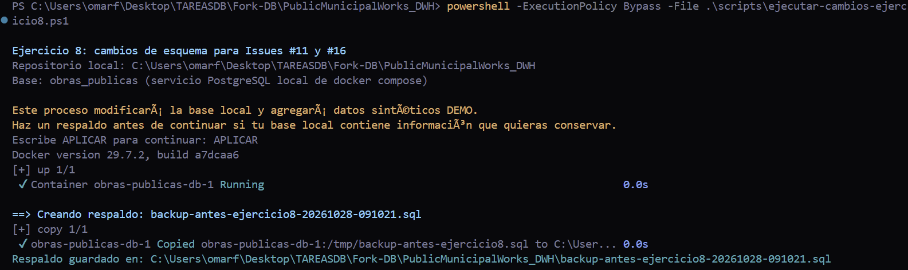
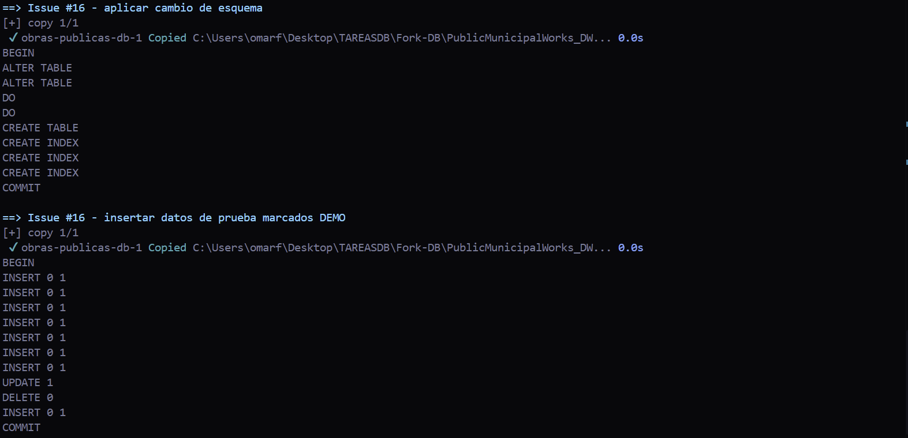
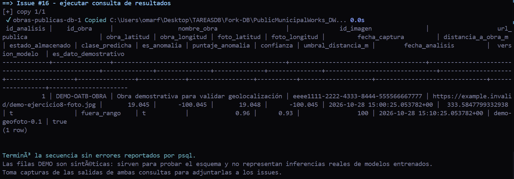

# Ejercicio 8 — Cambio de esquema para la issue #16

**Propuesta:** [Guardar la ubicación real de las obras y comprobar que las fotos se tomaron ahí](https://github.com/oatbrend/PRACTICA2-DB/issues/16)  
**Autor de la issue original:** `oatbrend`  
**Área:** Ingeniería en Inteligencia Artificial  
**Fecha de ejecución documentada:** 28 de octubre de 2026  
**Motor:** PostgreSQL ejecutado con Docker Compose, sobre la base local `obras_publicas`.

## 1. Tablas, columnas y restricciones nuevas o modificadas

En `obra` se agregan `latitud`, `longitud`, `precision_ubicacion_m` y `metodo_ubicacion`. En `imagenes_informe` se añaden `latitud`, `longitud`, `fecha_captura`, `distancia_a_obra_m` y `fuera_de_rango`. Las columnas existentes no se sustituyen, para conservar los registros históricos.

Se crea `analisis_ubicacion_ia`, que guarda cada salida del análisis vinculada con la fotografía mediante la FK `id_imagen`. Sus atributos incluyen la clase predicha, si se detectó anomalía, puntaje de anomalía, confianza, distancia calculada, umbral de distancia, fecha del análisis, versión del modelo y un campo `JSONB` con detalles adicionales. La tabla mantiene el historial: una nueva evaluación puede insertar otra fila sin eliminar el resultado anterior.

El DDL añade restricciones `CHECK` para limitar la latitud a [-90, 90], longitud a [-180, 180], puntajes y confianza a [0, 1], distancia y precisión a valores no negativos y método de ubicación a `gps`, `manual` o `aproximada`. También crea índices para recuperar los análisis de una imagen por fecha y encontrar resultados marcados como anomalía.

## 2. Justificación de los tipos de datos

Las coordenadas y distancias utilizan `DOUBLE PRECISION` porque requieren valores decimales; la precisión y la distancia se expresan en metros. `TIMESTAMPTZ` conserva los instantes de captura y análisis, algo relevante cuando los dispositivos registran datos en zonas horarias diferentes. `VARCHAR(100)` guarda la versión del modelo, por ejemplo `geo-anomaly-v1.2`. `JSONB` permite almacenar parámetros o detalles adicionales de la salida sin alterar la tabla cada vez que cambie el formato del modelo. `BOOLEAN` representa si la foto fue marcada fuera de rango y si el análisis detectó una anomalía.

La distancia entre coordenadas se puede calcular mediante la fórmula de Haversine sin instalar PostGIS. PostGIS podría añadirse en el futuro para usar tipos geográficos y consultas espaciales indexadas. El requisito de IA también necesita almacenar la **salida** del modelo, no solo coordenadas de entrada; por eso `analisis_ubicacion_ia` conserva predicción, puntajes, timestamp, versión y FK a la imagen evaluada.

## 3. Consulta nueva y resultado

La consulta está en [`db/diagramas/issue16/consulta-ubicacion-ia.sql`](https://github.com/OmarFloresIIA/PublicMunicipalWorks_DWH/blob/TestDefinitivo/db/diagramas/issue16/consulta-ubicacion-ia.sql). Une `analisis_ubicacion_ia`, `imagenes_informe`, `informes` y `obra`. Devuelve la obra y fotografía evaluadas, ambas ubicaciones, distancia, bandera fuera de rango, clase predicha, puntaje de anomalía, confianza, umbral, marca temporal y versión del modelo. Depende de la nueva tabla de análisis y de las columnas geográficas agregadas, por lo que no puede ejecutarse sobre el esquema original sin aplicar el cambio.

La consulta final devolvió **1 fila**. Para la evidencia sintética se registraron estos valores:

| Campo | Resultado observado |
|---|---:|
| Obra de demostración | `DEMO-OATB-OBRA` |
| Latitud de la obra | 19.045 |
| Longitud de la obra | -100.045 |
| Latitud de la fotografía | 19.048 |
| Longitud de la fotografía | -100.045 |
| Distancia calculada | 333.58 m aproximadamente |
| Umbral empleado en la prueba | 100 m |
| `fuera_de_rango` | `true` |
| Clase registrada | `fuera_rango` |
| `es_anomalia` | `true` |
| Puntaje de anomalía | 0.96 |
| Confianza registrada | 0.93 |
| Versión | `demo-geofoto-0.1` |
| `es_dato_demostrativo` | `true` |

Como la distancia sintética es mayor que el umbral de prueba, el registro queda marcado como fuera de rango. La clase y los puntajes se cargan como resultado demostrativo; no provienen de la inferencia de un modelo entrenado.

## 4. Nota de media cuartilla: regla, estrategia y datos existentes

El cambio aplica la **regla 1** al ampliar la información almacenada sobre Obra y Evidencia, y la **regla 4** al vincular el análisis con la imagen evaluada mediante una clave foránea. La salida del modelo se almacena en una tabla independiente para no mezclar los metadatos originales de la fotografía con predicciones que pueden cambiar entre versiones. Así se pueden conservar varias evaluaciones de una misma evidencia, comparar versiones del modelo y saber cuándo se produjo cada resultado. La FK a `imagenes_informe(id_imagen)` identifica exactamente la fotografía examinada; mediante `informes` se recupera la obra correspondiente.

Se eligieron `DOUBLE PRECISION` para coordenadas, distancias y puntajes decimales, `TIMESTAMPTZ` para captura y análisis, `BOOLEAN` para las banderas, `VARCHAR` para la versión del modelo y `JSONB` para detalles complementarios. Las restricciones `CHECK` evitan coordenadas fuera de rango y puntajes inválidos. La prueba usa Haversine y un límite demostrativo de 100 metros; ese límite debe validarse con las condiciones reales de captura y la precisión GPS, no interpretarse como una regla universal.

Los registros que ya existían en `obra` e `imagenes_informe` se conservaron. Sus nuevas coordenadas, fechas, distancias y banderas quedan `NULL` hasta que se recuperen datos GPS válidos o se procesen las evidencias históricas; no se inventa su ubicación. `analisis_ubicacion_ia` comienza sin resultados y recibe filas cuando se ejecuta el proceso de análisis. En esta evidencia, el script de prueba crea una obra y una imagen sintéticas, calcula una distancia y guarda una salida etiquetada como demostrativa. Esto confirma la estructura de datos y la consulta, pero no sustituye la integración y ejecución de un modelo de aprendizaje automático real.

## 5. Evidencia de ejecución

Las siguientes capturas corresponden a la ejecución local mediante Docker Compose y `psql`. El respaldo se generó antes de aplicar la secuencia; la segunda captura muestra la aplicación del esquema y la carga de datos de demostración; la tercera contiene la consulta final y el resultado de una fila.

### Respaldo previo

### Aplicación del esquema y carga de demostración

### Resultado final de la consulta: 1 fila

> **Alcance de la evidencia:** las capturas comprueban la ejecución del DDL, la carga de datos de prueba y la consulta. La etiqueta `es_dato_demostrativo = true` señala que la clasificación y sus puntajes se generaron para probar el esquema; no son una predicción de un modelo entrenado.

## 6. Archivos relacionados

- Cambio de esquema: [`db/diagramas/issue16/cambio-usuario.sql`](https://github.com/OmarFloresIIA/PublicMunicipalWorks_DWH/blob/TestDefinitivo/db/diagramas/issue16/cambio-usuario.sql)
- Consulta: [`db/diagramas/issue16/consulta-ubicacion-ia.sql`](https://github.com/OmarFloresIIA/PublicMunicipalWorks_DWH/blob/TestDefinitivo/db/diagramas/issue16/consulta-ubicacion-ia.sql)
- Datos demostrativos: [`db/diagramas/issue16/datos-demo-ubicacion-ia.sql`](https://github.com/OmarFloresIIA/PublicMunicipalWorks_DWH/blob/TestDefinitivo/db/diagramas/issue16/datos-demo-ubicacion-ia.sql)
- Script para ejecutar ambas issues: [`scripts/ejecutar-cambios-ejercicio8.ps1`](https://github.com/OmarFloresIIA/PublicMunicipalWorks_DWH/blob/TestDefinitivo/scripts/ejecutar-cambios-ejercicio8.ps1)
